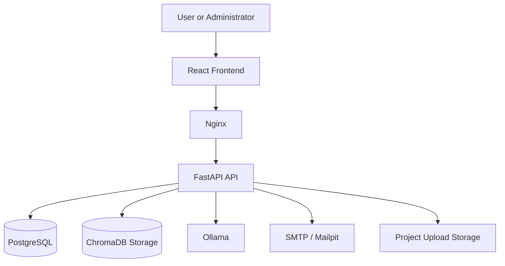

# ATLAS

**AI-Assisted Requirement Traceability and Change Impact Analysis Platform**

ATLAS is a full-stack software engineering platform for transforming project documents into structured requirements, connecting those requirements to technical artifacts, governing review and approval, analyzing change impact, generating traceable test cases, evaluating release readiness, and answering project questions from indexed evidence.

## Release

**Current stable version:** `v1.0.1`

ATLAS v1.0.1 is the first stable platform release. It includes production-oriented security controls, responsive user and administrator interfaces, database migrations through `0013`, automated backend tests, lint validation, health checks, backup and restore tooling, and deployment documentation.

## Why ATLAS

Software requirements, design artifacts, APIs, database objects, test cases, release evidence, and project decisions are often stored in separate tools. This makes traceability difficult to maintain and increases the risk of missing affected components when requirements change.

ATLAS provides a connected workflow:

```text
Documents
   ↓
Requirements
   ↓
Reviews and Baselines
   ↓
Traceability
   ↓
Change Impact
   ↓
Test Cases
   ↓
Release Readiness
   ↓
Analytics and Audit
```

## Core capabilities

### Authentication and account security

- Secure registration and login
- Argon2 password hashing
- JWT authentication with issuer, audience, expiry, token ID, and session-version validation
- Secure password recovery with one-time, expiring reset links
- Session invalidation after password reset, suspension, or administrative action
- Persistent rate limiting for authentication and recovery endpoints
- Role-based access control for users and administrators

### Project and document management

- Owner-isolated project management
- PDF and DOCX upload
- File size, extension, binary signature, and archive safety validation
- SHA-256 duplicate detection
- Corrupted, encrypted, unsafe, and compression-bomb document rejection
- Text extraction with project-scoped storage and processing status

### Requirement intelligence

- Requirement extraction from uploaded documents
- Functional and non-functional classification
- Non-functional requirement categories
- Confidence and ambiguity scoring
- Manual requirement creation and editing
- Immutable requirement version history
- Requirement status and review workflow

### Governance and baselines

- Reviewer assignment, priority, and due dates
- Comments, approval, rejection, and decision rationale
- Immutable requirement baselines
- Active and archived baseline states
- Baseline-to-current and baseline-to-baseline comparison
- Governance audit history

### Traceability

- API, database, UML, document, and test artifacts
- Manual and explainable suggested links
- Accept and reject workflow
- Requirement and artifact coverage
- Traceability matrix and uncovered-item identification

### Change-impact analysis

- Requirement version comparison
- Direct and transitive affected artifacts
- Explainable risk scoring
- Low, medium, high, and critical severity
- Persistent impact reports and history
- Linked test-case review signals after requirement changes

### AI project assistant

- Project-isolated semantic indexing
- Sentence Transformer embeddings
- Persistent ChromaDB storage
- Ollama-based grounded answers
- Numbered evidence citations
- Semantic search and conversation history
- Retrieval-only fallback when generation is unavailable

### Test Case Intelligence

- Manual and AI-assisted test-case creation
- Preconditions, test data, numbered steps, and expected results
- Functional, negative, boundary, security, performance, integration, and regression test types
- Requirement-to-test traceability
- Draft, review, approval, rejection, needs-review, and archive states
- Test-case version history and approved coverage analytics

### Release Readiness and Quality Gates

- Release-candidate planning with selected baselines, requirements, and test cases
- Configurable traceability, approved-test, impact-risk, and overdue-review thresholds
- Explainable quality-gate outcomes
- Weighted readiness score
- Ready, At Risk, Blocked, and Not Evaluated classifications
- Review, sign-off, publication locking, and immutable release snapshots
- Release comparison and JSON/CSV reports

### Analytics and reporting

- Explainable project-health score
- Requirement, ambiguity, review, and category analytics
- Traceability and test-coverage analytics
- Impact-risk and severity analytics
- Assistant-index and usage statistics
- Recent project activity
- HTML, JSON, and CSV exports

### Administration and platform operations

- Administrator-only routes enforced in the backend and frontend
- Live directory of existing users and their project/artifact totals
- Role management, suspension, activation, and session invalidation
- Secure password-recovery triggers
- Final-active-administrator protection
- Platform-wide project oversight
- Project archive, restore, and audited ownership transfer
- Authentication and administrative audit logs
- Database, migration, AI, email, storage, and processing health views
- Configurable platform settings

## Technology stack

| Layer | Technology |
|---|---|
| Frontend | React, Vite, Tailwind CSS, React Router, Axios |
| Backend | FastAPI, Pydantic, SQLAlchemy asyncio |
| Database | PostgreSQL |
| Migrations | Alembic |
| Documents | PyMuPDF, python-docx |
| Embeddings | Sentence Transformers |
| Vector database | ChromaDB |
| Local LLM | Ollama |
| Security | JWT, Argon2, HMAC-based rate-limit identifiers |
| Deployment | Docker Compose, Nginx |
| Quality | Pytest, Ruff |

## Architecture



ATLAS uses project-scoped authorization in the API. The frontend never acts as the authoritative source for permissions, risk, readiness, or coverage calculations.

## Prerequisites

- Docker Desktop with Linux containers
- Docker Compose
- Git
- Ollama for locally generated AI answers

## Quick start

### 1. Clone the repository

```powershell
git clone https://github.com/JoshuaJ290304/ATLAS.git
cd ATLAS
```

### 2. Create the environment file

```powershell
Copy-Item .env.example .env
```

Set a strong private `JWT_SECRET_KEY` and review the database, CORS, upload, session, email, and AI settings before startup.

Never commit `.env`, uploaded files, vector data, downloaded models, database dumps, or backups.

### 3. Start ATLAS

```powershell
docker compose up --build -d
docker compose ps
```

### 4. Open the services

- Application: `http://localhost:5173`
- Backend liveness: `http://localhost:8000/api/v1/health/live`
- Backend readiness: `http://localhost:8000/api/v1/health/ready`
- Frontend health: `http://localhost:5173/healthz`
- Local email inbox: `http://localhost:8025`

API documentation may be enabled in a development environment and should remain disabled in hardened production configuration.

## Ollama setup

Install Ollama on the host, then pull the configured model:

```powershell
ollama pull qwen3:4b-instruct
ollama list
```

For Docker Desktop on Windows, configure:

```env
OLLAMA_BASE_URL=http://host.docker.internal:11434
```

ATLAS can provide retrieval-only evidence when Ollama is unavailable and fallback is enabled.

## Database migrations

| Revision | Purpose |
|---|---|
| `0001` | Users and projects |
| `0002` | Documents |
| `0003` | Requirements |
| `0004` | Artifacts and trace links |
| `0005` | Requirement snapshots and impact reports |
| `0006` | AI assistant indexes and conversations |
| `0007` | Requirement reviews and baselines |
| `0008` | Governance completeness fields |
| `0009` | Test Case Intelligence |
| `0010` | Release Readiness and Quality Gates |
| `0011` | Password recovery |
| `0012` | Administration and platform controls |
| `0013` | Persistent security rate limits |

Check the current revision:

```powershell
docker compose exec -T backend sh -lc 'alembic current 2>/dev/null'
```

Apply pending migrations:

```powershell
docker compose exec -T backend alembic upgrade head
```

## Verification

Run the complete backend test suite:

```powershell
docker compose exec -T backend pytest -q -p no:cacheprovider
```

Run Ruff in the non-root backend container:

```powershell
docker compose exec -T backend sh -lc \
  'mkdir -p /tmp/ruff-cache && RUFF_CACHE_DIR=/tmp/ruff-cache ruff check .'
```

Build the production frontend image:

```powershell
docker compose build frontend
```

Validate Nginx:

```powershell
docker compose exec -T frontend nginx -t
```

Expected stable-release verification:

```text
64 backend tests passed
Ruff checks passed
Alembic revision 0013
Frontend production build passed
Backend and frontend health checks returned HTTP 200
```

## Backup and restore

Create a database and source backup:

```powershell
Set-ExecutionPolicy -Scope Process Bypass
.\scripts\backup_atlas.ps1
```

Restore from a verified backup:

```powershell
.\scripts\restore_atlas.ps1
```

Review [Backup and Restore](docs/BACKUP_RESTORE.md) before restoring data.

## Documentation

- [Installation Guide](docs/INSTALLATION.md)
- [User Guide](docs/USER_GUIDE.md)
- [Administrator Guide](docs/ADMIN_GUIDE.md)
- [Architecture](docs/ARCHITECTURE.md)
- [Security](docs/SECURITY.md)
- [Testing Report](docs/TESTING_REPORT.md)
- [Backup and Restore](docs/BACKUP_RESTORE.md)
- [Known Limitations](docs/KNOWN_LIMITATIONS.md)
- [Demonstration Script](docs/DEMO_SCRIPT.md)
- [Changelog](CHANGELOG.md)

## Security notes

- Do not use default secrets or database passwords in production.
- Restrict CORS and trusted hosts to approved domains.
- Keep debug mode and public API documentation disabled in production.
- Use HTTPS and preserve the provided security headers.
- Back up PostgreSQL before upgrades.
- Review uploaded-document controls and storage permissions before public deployment.
- Do not expose SMTP, JWT, database, or AI service credentials through the UI or logs.

## Known limitations

- Scanned PDFs require OCR, which is not included.
- PDF citations identify pages and extracted evidence rather than exact page coordinates.
- AI output depends on the configured local model and should be reviewed against cited evidence.
- Git hosting, issue-tracker synchronization, source-code parsing, and CI/CD integrations are not included in v1.0.1.
- Multi-organization tenancy and real-time collaborative editing are not included.

See [Known Limitations](docs/KNOWN_LIMITATIONS.md) for additional details.

## Release history

| Version | Description |
|---|---|
| `v0.1.0` | Authentication, projects, and platform foundation |
| `v0.2.0` | Document processing |
| `v0.3.0` | Requirement intelligence |
| `v0.4.0` | Traceability engine |
| `v0.5.0` | Change-impact analysis |
| `v0.6.0` | AI project assistant |
| `v0.7.0` | Analytics, reporting, UI, and validation |
| `v0.8.0` | Reviews and baselines |
| `v0.8.1` | Governance completeness |
| `v0.9.0` | Test Case Intelligence |
| `v0.10.0` | Release Readiness and Quality Gates |
| `v0.10.1` | Dashboard modules and secure password recovery |
| `v0.11.0` | Administration and platform operations |
| `v1.0.1` | Stable platform release |

## License

See [LICENSE](LICENSE) for the repository license terms.

